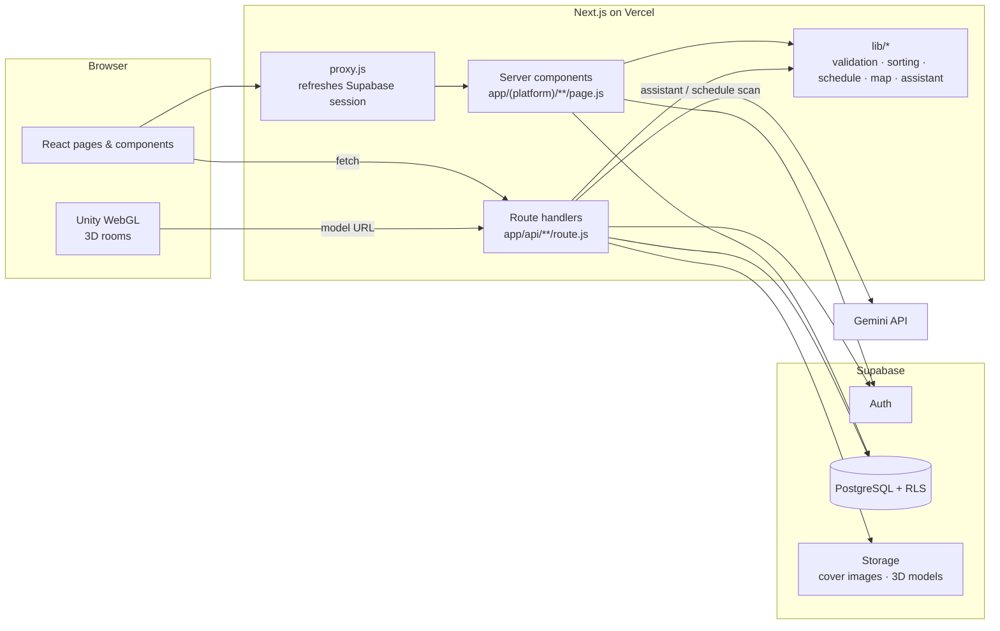

# GatorAid

**Campus event discovery for San Francisco State University: find what's happening, see where it is, and step inside the room before you go.**

**Live site:** https://sfsu-csc648-06-fall26-team06-three.vercel.app

**Course:** CSC 648/848 Software Engineering · Section 6 · Team 6 · Fall 2026

---

## Contents

- [Project Overview](#project-overview)
- [Team](#team)
- [Milestones](#milestones)
- [Features](#features)
- [Tech Stack](#tech-stack)
- [Software Architecture](#software-architecture)
- [Repository Layout](#repository-layout)
- [Routes](#routes)
- [Frontend](#frontend)
- [Backend](#backend)
- [Database](#database)
- [Local Setup](#local-setup)
- [Testing](#testing)
- [Git Workflow](#git-workflow)
- [Deployment](#deployment)
- [License](#license)

---

## Project Overview

### The problem

Campus information at SFSU is spread across university websites, department pages, social media and flyers. Students often miss events they would have enjoyed, or don't know where those events are held. Even when a flyer gives the time and the building, it can't tell a student what the room is like: how big it is, how it's laid out, whether it's accessible, or whether it's a space they'd feel comfortable walking into alone. These gaps matter most for new and transfer students who don't know campus yet, and for students who need to check a venue's accessibility ahead of time.

### Our solution

GatorAid is a web app that helps SFSU students discover campus events and find their way to them, all in one place:

- **Discover:** explore and RSVP to events, and get recommendations based on your interests *and* your class schedule.
- **Find:** see every event on an interactive campus map.
- **Step inside:** explore the venue in 3D before you go.
- **Ask:** Allison, our AI assistant, answers questions about events and campus.
- **Host:** any signed-in student can create and publish events.

### Niantic 3D scans

What sets GatorAid apart is Niantic's 3D scans. A flyer can tell a student when and where an event is, but not what it will feel like to walk in. Venues are captured with Niantic's Scaniverse and shown in the browser, so students can step inside before they arrive and see the room's size and layout and whether it works for them. By connecting real campus spaces to the events happening in them, GatorAid turns "I might go" into "I know where I'm going."

Next, we're making those spaces social: students who RSVP will appear as customizable 3D avatars inside the venue, and they can see who else is going and message them before the event starts.

---

## Team

| Team Member | Role |
| --- | --- |
| **Emely Sarceno Bravo** | Team Lead |
| **David Gomez** | Front-End Lead |
| **Kelsey Codilla** | Back-End Lead |
| **Emerson Berido** | Scrum Master |
| **Tavasya Ganpati** | GitHub Master |
| **Phong Nguyen** | AI Lead |

---

## Milestones

| Milestone | Date | Report | What we accomplished |
| --- | --- | --- | --- |
| **M0** | Sep 15, 2026 | [M0 report](milestones/m0/CSC%20648-848%20M0%20section%206%20Team%206.doc) | Formed the team and roles, chose the tech stack, deployed the team About page on Vercel, and set up the repo and Supabase project. |
| **M1** | Sep 29, 2026 | [M1 report](milestones/m1/CSC%20648-848%20M1%20Section%206%20Team%206.doc) | Defined GatorAid: executive summary, personas, use cases, functional and non-functional requirements, and the 2D map → 3D room concept. |
| **M2** | Oct 20, 2026 | [M2 report](milestones/m2/CSC%20648-848%20M2%20Section%206%20Team%206.docx) | Data definitions v2, prioritized requirements, UI mockups and storyboards, high-level architecture and database design, the first end-to-end features (host events, interests, saving, RSVP), 2D interactive map, Explore Events page, For You page, and 3D scans. |
| **M3** | Nov 4, 2026 | [M3 report](milestones/m3/CSC%20648-848%20M3%20Section%206%20Team%206.docx) | Vertical prototype demo: every feature runs UI → API → Supabase with RLS. Added more 3D rooms, AI Schedule Scanner, Calendar, schedule-aware recommendations, and the Allison chatbot, plus an action plan from instructor feedback. |
| **M4** | — | *Coming soon* | Beta: UI refresh, sorting, schedule types, RSVP capacity, and a usability/QA pass. |
| **M5** | — | *Coming soon* | Final product and demo. |

---

## Features

### For students

| Feature | What it does |
| --- | --- |
| **Homepage** | Shows what GatorAid is for, the events happening this week (or the next upcoming ones if the week is empty), a campus map preview, a 3D room preview and live project stats. |
| **Explore events** | Browse every published upcoming event. Search and filter by date, category, location and accessibility. Sort by best match, soonest, latest, A–Z, free first or newest. |
| **Event details** | Date, time, location, capacity, spots left, accessibility, contact and description, with a mini map and a link into the 3D room when one exists. |
| **Save & RSVP** | Save events for later and RSVP as Going, Interested or Not going. These are independent of each other. Full events refuse new "Going" RSVPs, and hosts can't RSVP to their own events. |
| **Interests & For You** | Pick the categories you care about. For You ranks matching events and explains why each one was recommended. |
| **AI Schedule Scanner** | Upload a photo or PDF of your schedule. Gemini extracts it into classes, work shifts, practices or other commitments. You review and confirm, and it's saved to your account. |
| **Schedule-aware events** | "Fits my schedule" filter, conflict badges on events, and a reminder before you RSVP to something that overlaps a commitment. |
| **Your calendar** | A week view of your RSVPs alongside your saved commitments. |
| **Allison (AI assistant)** | Ask about campus events, locations and how to use GatorAid. Answers come from live GatorAid data and link to real events. Allison can also summarize or compare events. |
| **Campus map** | A to-scale 2D SFSU map built from OpenStreetMap data. Buildings with upcoming events are highlighted, and you can filter events by time and category, then save or RSVP from the map. |
| **3D room exploration** | Rooms scanned with Scaniverse open in the browser as a Unity WebGL scene, reached from the map or an event page. |
| **Dark mode & accessibility** | Light and dark themes, keyboard-friendly navigation, and dedicated Accessibility, Privacy and FAQ pages. |

### Meet attendees before the event *(in development)*

| Feature | What it does |
| --- | --- |
| **Customizable 3D avatars** | Each student creates a unique avatar: gender presentation, skin tone, hair style, hair color and outfit color. It's created during onboarding or from Profile, with a live Unity preview. |
| **RSVP avatars in the venue** | When a student RSVPs "Going", their avatar appears inside the event's scanned venue. Only students who RSVP'd can see who else is going. Students who haven't RSVP'd see a blurred room. |
| **Attendee hover card** | Hover (or tap on phone) another avatar to see their name, year and major, SFSU email, interests and the interests you share, with **View profile** and **Message** buttons. |
| **Attendee profiles** | A public profile with the student's avatar, interests and the events you're both going to. Includes Block and Report. |
| **In-app messaging** | Direct messages between students going to the same event, grouped by event in a Messages inbox. Messages update in real time, with read receipts ("Seen · time"), a typing indicator, unread counts and icebreakers based on shared interests. |
| **Privacy controls** | Students choose whether their avatar and email are shown, and can hide their avatar for a single event while keeping their RSVP. |

### For hosts (any signed-in student)

| Feature | What it does |
| --- | --- |
| **Create events** | Title, description, date/time, campus building and room (76 SFSU locations with room suggestions), categories, capacity, accessibility, contact info and a cover image. |
| **Draft → preview → publish** | Events start as private drafts. Hosts preview them exactly as students will see them, then publish. |
| **Edit, cancel & delete** | Hosts can only change their own events. |
| **My hosted events** | Each event's status plus RSVP and save counts. Hosts see counts only, never which students. |

### Design (Figma)

The full UI design for every feature above, including the 3D avatar and messaging screens, is in Figma:

| Page | What's there |
| --- | --- |
| [Wireframes](https://www.figma.com/design/RauwJQUtWwn20Z55nT2ZdZ/GatorAid-V2?node-id=2007-2) | Low-fidelity layouts for every screen, with annotations |
| [Mockups](https://www.figma.com/design/RauwJQUtWwn20Z55nT2ZdZ/GatorAid-V2?node-id=2007-3) | High-fidelity desktop and phone screens built from the GatorAid design system |
| [Prototype](https://www.figma.com/design/RauwJQUtWwn20Z55nT2ZdZ/GatorAid-V2?node-id=2007-4) | Clickable desktop and phone flows (press Present and pick a flow) |
| [User Flows](https://www.figma.com/design/RauwJQUtWwn20Z55nT2ZdZ/GatorAid-V2?node-id=2007-5) | How students and hosts get from start to finish in each task |

---

## Tech Stack

| Layer | Technology |
| --- | --- |
| Framework | **Next.js 16** (App Router, server components, route handlers) |
| UI | **React 19**, **Tailwind CSS v4**, lucide-react icons |
| Database & auth | **Supabase** (managed PostgreSQL, Supabase Auth, Row-Level Security, Storage) |
| AI | **Google Gemini API** (`@google/genai`) for Allison and the Schedule Scanner |
| 3D capture | **Scaniverse** (Niantic Spatial) |
| 3D rendering | **Unity WebGL** (`.glb` scenes and avatars) |
| Design | **Figma** (wireframes, mockups, prototype, user flows) |
| Hosting | **Vercel** (production + preview deployments) |
| Tests & lint | Node's built-in test runner (`node --test`), ESLint 9 |

---

## Software Architecture



**How a request flows:**

1. **The proxy refreshes the session.** `proxy.js` (Next 16's replacement for middleware) refreshes the Supabase session cookie on every request.
2. **Server components read data.** Pages query Supabase directly with the signed-in user's session, so **RLS decides what each user can see**.
3. **Route handlers write data.** Mutations go through `app/api/**`: they validate input (`lib/*`), check that the request is same-origin, and derive the user from the session (never from the request body).
4. **Rules are enforced twice.** Capacity limits, "no RSVP to your own event" and "only published events are public" are enforced in the API *and* in the database (triggers and RLS).
5. **Gemini is called only from the server.** API keys never reach the browser.

---

## Repository Layout

```
app/                            ── Pages and API (Next.js App Router)
│
├── page.js                     Homepage
├── about/                      Team "Meet the team" page
├── (platform)/                 App pages that share the header/footer layout
│   ├── events/                 Explore, event details, For You
│   ├── host/events/            Host dashboard, create, edit, preview
│   ├── map/                    Interactive campus map
│   ├── rooms/                  3D rooms (Unity)
│   ├── assistant/              Allison, the AI assistant
│   ├── schedule/  calendar/    Schedule Scanner, your week
│   ├── saved/  interests/      Saved events, interests
│   ├── login/                  Sign in / create account
│   └── about-gatoraid/  faq/  accessibility/  privacy/
└── api/                        Route handlers (REST JSON API)

────────────────────────────────────────────────────────────────────────

components/                     ── Reusable UI
│
├── gatoraid/                   Site header/footer, logo, shared event UI, global styles
├── home/  about/               Homepage and About sections
├── student/                    Save/RSVP buttons, schedule-conflict reminder
├── schedule/  calendar/        Schedule Scanner and calendar views
├── assistant/                  Allison chat
└── map/  rooms/                Campus map and 3D room viewers

────────────────────────────────────────────────────────────────────────

lib/                            ── Shared logic (used by pages and the API, unit-tested)
│
├── supabase/                   Server and browser Supabase clients
├── events/                     Validation, sorting, attendance, accessibility
└── schedule/  calendar/  student/  map/  rooms/  assistant/

────────────────────────────────────────────────────────────────────────

supabase/migrations/            SQL migrations, applied in timestamp order
public/unity/                   Unity WebGL build for 3D rooms
scripts/map/                    Generate campus map data from OpenStreetMap
tests/                          Node test suites (*.test.mjs)
docs/                           Feature docs: host events, student features, map, calendar
milestones/                     Milestone reports (M0–M5)
proxy.js                        Refreshes the Supabase session for pages and API routes
```

---

## Routes

### Pages

| Route | Page |
| --- | --- |
| `/` | Homepage |
| `/events` | Explore events (search, filter, sort) |
| `/events/[eventId]` | Event details, save & RSVP |
| `/events/for-you` | Personalized recommendations |
| `/saved` | Saved events |
| `/interests` | Choose interests |
| `/schedule` | AI Schedule Scanner and saved commitments |
| `/calendar` | Your week: RSVPs + commitments |
| `/assistant` | Allison, the AI assistant |
| `/map` | Interactive campus map |
| `/rooms/[roomId]/3d` | 3D room (Unity) |
| `/host/events` | Host dashboard |
| `/host/events/new` · `/host/events/[id]/edit` · `/host/events/[id]/preview` | Create · edit · preview an event |
| `/login` | Sign in / create account |
| `/about` · `/about-gatoraid` · `/faq` · `/accessibility` · `/privacy` | Team, mission and info pages |

### API

All mutations require a signed-in session and a same-origin request. JSON in, JSON out.

| Endpoint | Methods | Purpose |
| --- | --- | --- |
| `/api/events` | GET | Published upcoming events |
| `/api/events/[eventId]` | GET | One event |
| `/api/events/for-you` | GET | Recommendations with reasons |
| `/api/events/[eventId]/saved` | GET, PUT, DELETE | Save / unsave |
| `/api/events/[eventId]/rsvps/me` | GET, PUT | Your RSVP status |
| `/api/users/me/interests` | GET, PUT | Your interests |
| `/api/users/me/saved-events` · `/api/users/me/rsvps` | GET | Your saved events · your RSVPs |
| `/api/users/me/schedule` | GET, PUT | Your saved commitments |
| `/api/users/me/schedule/scan` | POST | Extract a schedule from an image/PDF (Gemini) |
| `/api/host/events` | GET, POST | Your hosted events · create a draft |
| `/api/host/events/[eventId]` | GET, PATCH, DELETE | Edit or delete your event |
| `/api/host/events/[eventId]/publish` | POST | Publish a draft |
| `/api/locations` · `/api/locations/[id]` · `/api/locations/[id]/events` | GET | Campus locations and their events |
| `/api/rooms/[roomId]/info` · `/api/rooms/[roomId]/3d-model` | GET | 3D room details and model URL |
| `/api/assistant` | POST | Ask Allison |

More detail: [docs/host-events.md](docs/host-events.md), [docs/student-features.md](docs/student-features.md), [docs/campus-map.md](docs/campus-map.md), [docs/calendar.md](docs/calendar.md).

---

## Frontend

- **App Router** with a shared `(platform)` layout: site header, footer and theme. Pages are server components by default; interactive pieces (filters, map, RSVP buttons, chat, scanner) are client components.
- **Design system** in `components/gatoraid/site.css` plus Tailwind v4 utilities: SFSU purple & gold palette, light/dark themes via CSS variables, and shared cards, pills and toggles.
- **Business logic lives in `lib/`** (sorting, schedule conflicts, validation), so it's shared by pages and the API and is unit-tested.
- **3D:** the Unity WebGL build in `public/unity/` loads a room's `.glb` scan.

## Backend

- **Next.js route handlers** in `app/api/**` form a small REST API. Each handler validates its input, resolves the user from the Supabase session, and returns clear errors (`401`, `403`, `404`, `409`, `422`).
- **Supabase** provides Auth, PostgreSQL, RLS and Storage. The app only uses the public (publishable) key; no service-role key is needed, because permissions live in the database.
- **Database functions & triggers** handle work that must be atomic or trusted: replacing a student's schedule, counting attendance, enforcing RSVP capacity, and blocking self-RSVP.
- **AI:** `app/api/assistant` grounds Gemini in live GatorAid data (events, locations), and `app/api/users/me/schedule/scan` returns structured commitments for the student to review.

## Database

PostgreSQL on Supabase. Every change is a migration in [`supabase/migrations/`](supabase/migrations).

| Table | Holds |
| --- | --- |
| `events` | Title, description, times, location/room, categories, capacity, accessibility, cover image, `publication_status` (draft/published), `status` (active/cancelled/completed), `host_id` |
| `categories` | Event categories (Technology, Career, Arts, …) |
| `locations` · `location_categories` | SFSU buildings and outdoor spaces with map positions |
| `rooms` | Scanned 3D rooms and their model files |
| `hosts` | Host display names |
| `student_preferences` | A student's interests |
| `saved_events` · `event_rsvps` | Saves and RSVPs (one row per user and event) |
| `student_class_schedules` | Saved commitments (class, work, practice, other) |

**Row-Level Security** is on for every table. Published events are public, drafts are visible only to their host, and personal tables (`saved_events`, `event_rsvps`, preferences, schedules) are readable and writable only by their owner.

**Migrations are applied by hand in the Supabase SQL editor, in timestamp order.** They are written to be safe to re-run. When a PR adds a migration, say so in the PR description so it gets applied to the shared project before merging.

---

## Local Setup

**Requirements:** Node.js 20+ and npm, plus access to the team's Supabase project (ask the Team Lead for an invite).

```bash
git clone https://github.com/Tavasya/SFSU-csc648-06-Fall26--team06.git
cd SFSU-csc648-06-Fall26--team06
npm install
cp .env.example .env.local     # then fill in the values below
npm run dev                    # http://localhost:3000
```

`.env.local`:

| Variable | Required | Notes |
| --- | --- | --- |
| `NEXT_PUBLIC_SUPABASE_URL` | Yes | Supabase → Project Settings → API |
| `NEXT_PUBLIC_SUPABASE_PUBLISHABLE_KEY` | Yes | Publishable (anon) key, safe for the browser |
| `GEMINI_API_KEY` | For AI features | Allison and the Schedule Scanner |
| `GEMINI_MODEL` | Optional | Overrides the default Gemini model |

Never commit `.env.local` or paste keys into issues, PRs or chat.

**Using your own Supabase project?** Run every file in `supabase/migrations/` in order in the SQL editor, then sign up in the app to create a user.

**Seeing different data than a teammate?** Check that your `NEXT_PUBLIC_SUPABASE_URL` points to the shared project, then clear any active filters on Explore.

| Command | Does |
| --- | --- |
| `npm run dev` | Start the dev server |
| `npm run build` / `npm start` | Production build / serve it |
| `npm test` | Run all unit tests |
| `npm run lint` | ESLint |

---

## Testing

`npm test` runs the suites in `tests/` with Node's built-in runner, with no extra dependencies. They cover:

- event validation, sorting and engagement counts
- student APIs, using an in-memory Supabase mock (saves, RSVPs, capacity, self-RSVP guard)
- calendar and schedule logic
- map data and room models
- the assistant's query parsing
- same-origin checks

Database rules (RLS, triggers) are checked manually with two test accounts, as described in `docs/student-features.md`.

---

## Git Workflow

```
feature/<name>  ──PR──▶  develop  ──PR──▶  main  ──▶  Vercel production
```

- **`main`** is production and is always deployable. It's only updated by merging `develop`.
- **`develop`** is the integration branch. All feature PRs target it.
- **Feature branches** are named `feature/<short-description>` (e.g. `feature/ui-refresh`) and branched from the latest `develop`.
- **Pull requests:**
  - Write a clear title and description: what changed, how to test it, and any migrations to apply.
  - At least one teammate reviews. The GitHub Master merges.
  - Run `npm test` and `npm run lint` before opening the PR.
  - Keep PRs focused, and sync with `develop` (merge or rebase) to resolve conflicts before review.
- **Commits** are small, with imperative messages ("Add RSVP capacity check").
- **Secrets** stay in `.env.local` and Vercel, never in git.

---

## Deployment

- **Vercel** builds the project automatically from GitHub.
  - Merges to `main` deploy to production: https://sfsu-csc648-06-fall26-team06-three.vercel.app
  - Every pushed branch and PR gets its own **preview URL** for review.
- Environment variables (Supabase URL/key, Gemini key) are set in Vercel → Project Settings → Environment Variables for both Production and Preview.
- Database migrations are **not** run by the deploy. Apply them in Supabase (see [Database](#database)) *before* merging code that depends on them.
- Unity WebGL builds are served as static files from `public/unity/`. Large 3D models are stored in Supabase Storage.

---

## License

Licensed under the [Apache License 2.0](LICENSE).
